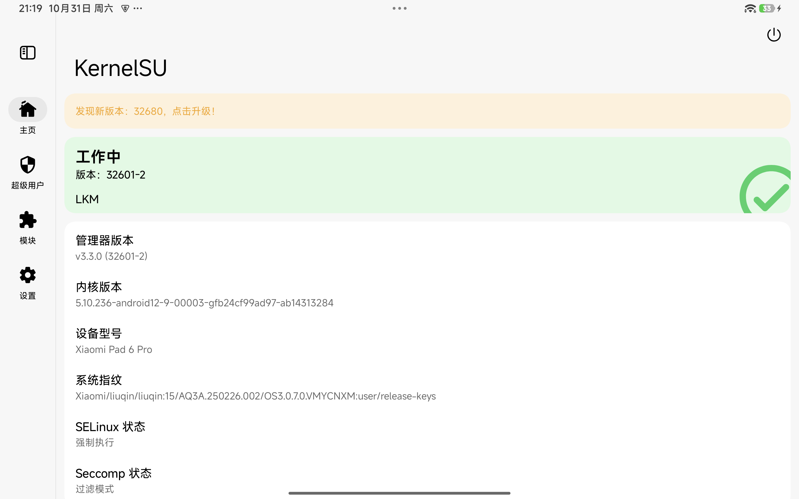

# Integration report: stock ROM `OS3.0.7.0.VMYCNXM`

Status: **community-verified on a real device (2026-10-31)**, not upstream-maintained.
This branch documents running the dual-boot port of this project against a **newer
stock ROM than the one the upstream installer pins**, and ships the one changed
file needed for it.

## Device and software actually used

| Item | Value |
|---|---|
| Device | Xiaomi Pad 6 Pro, codename `liuqin`, model `23046RP50C`, 256 GB |
| SoC | Qualcomm SM8475 (Snapdragon 8+ Gen 1) |
| Bootloader | unlocked (`ro.boot.verifiedbootstate=orange`) |
| Stock Android used | **`OS3.0.7.0.VMYCNXM`** (Android 15, build `AQ3A.250226.002`) |
| Android build fingerprint | `Xiaomi/liuqin/liuqin:15/AQ3A.250226.002/OS3.0.7.0.VMYCNXM:user/release-keys` |
| Android kernel | `5.10.236-android12-9-00003-gfb24cf99ad97-ab14313284` |
| Ubuntu | Ubuntu 26.04 LTS, project kernel `6.17.0-rc1` |

## Why this integration exists

The upstream installer verifies the stock ROM directory against the checksums
pinned in `liuqin-rom-images.json`, which identify
`OS2.0.6.0.VMYCNXM` (2025-03-18). `verify_rom()` refuses any other release.
`--allow-unverified` does **not** bypass this; it only relaxes the bundle
status check.

`OS3.0.7.0.VMYCNXM` ships the same image set with the same partition geometry
(`boot` 201326592 B, `vendor_boot` 100663296 B, `dtbo` 25165824 B, `NON-HLOS`
114511872 B, sparse `super`), and reports `anti_version=1`, which matches the
device fuse (`fastboot getvar anti` prints `1`). The checksums naturally differ,
so the only required change is to let the installer accept the local bytes.

## What is changed relative to upstream

Only `verify_rom()` in `install.py`. The shipped `tools/install_os3070.py` is
otherwise byte-identical to upstream `install.py` (same MIT licence and
headers). The patched branch replaces the hard refusal with a warning and
recomputes the per-image identity from the local files, keeping the pinned
partition mapping and the sparse flag:

```diff
-        if path.stat().st_size != entry['bytes'] or sha(path) != entry['sha256']:
-            parser.error('ROM image does not match the pinned ' + table['rom'] + ' release: ' + name ...)
-        selected[name] = dict(entry, path=path)
+        actual_bytes = path.stat().st_size
+        actual_sha = sha(path)
+        if actual_bytes != entry['bytes'] or actual_sha != entry['sha256']:
+            print('WARN: ' + name + ' differs from pinned ' + table['rom'] +
+                  ' (using local bytes; unpinned ROM test)')
+        selected[name] = dict(entry, path=path, bytes=actual_bytes, sha256=actual_sha)
```

Everything else — partition planning, the zero-filled project boot image, the
RAM installer, the dual-boot layout, the switch store — is unchanged.

## Procedure used

1. **Full fastboot flash of the stock ROM** `OS3.0.7.0.VMYCNXM` (extracted
   fastboot package) so that firmware, `super`, `modem`, `bluetooth` and `dsp`
   all come from the same release as the Android system. The stock
   `flash_all.bat` cannot be used verbatim with platform-tools: it names
   `*_ab` partitions. Flashing was done with explicit `_a`/`_b` targets.
   * platform-tools 37 was used for most partitions;
   * `vm-bootsys` reported `failed to check sparse crc` with 37 (newer fastboot
     skips the AVB footer on sparse images) and succeeded with the fastboot
     29.0.5 bundled in MiFlash 2022.
2. **Dual-boot installation** with the modified installer:

   ```sh
   python tools/install_os3070.py --bundle <bundle-dir> --serial <fastboot-serial> \
     --backup <backup-dir> --erase-userdata --layout dual \
     --rom-dir <extracted OS3.0.7.0 ROM> --yes
   ```

   Resulting layout (same as upstream defaults): `userdata` 96 GiB,
   `linux_root` 32 GiB, `linux_home` 97 GiB; both systems boot from slot A.
3. **KernelSU Android boot image** using the upstream v0.6.0 bundle tools and
   the pinned KernelSU v3.3.0 assets:

   ```sh
   python tools/patch-android-boot-ksu.py \
     --boot <ROM>/images/boot.img \
     --ksuinit <ksuinit-aarch64> \
     --lkm <lkm-aarch64-android12-5.10_kernelsu.ko> \
     --out boot-ksu.img --report boot-ksu-report.json
   ```

   The patched image identifies as an Android boot image (header v4) and is
   imported from Ubuntu with `sudo liuqin-switch import-android boot-ksu.img`,
   then activated with `sudo liuqin-switch to-android`.
4. **Android side**: install the KernelSU manager APK and the project module
   `liuqin_boot_ubuntu-v0.3.zip` from the manager. The module's WebUI
   "Reboot to Ubuntu" button then performs the Android -> Ubuntu switch.

## Verification

Both switch directions were exercised on the device:

* **Android -> Ubuntu** via the KernelSU module (writes `boot_a`, verifies it
  read-back, reboots) — Ubuntu 26.04 booted.
* **Ubuntu -> Android** via `sudo liuqin-switch to-android` — Android 15 booted.

`liuqin-switch status` on Ubuntu after the switch:

```
running slot:     a
boot_a must hold: the Ubuntu image from the store [ubuntu]   (when running Ubuntu)
store/ubuntu    ok  7a368e58291f974f1cebd1e91e81ce8edc7256a19f75c4baea3fffd883157900
store/android   ok  2a39502e1b587740c6a643b963de529e0a8a7dc50811553c8817a2c5128bdde4
```

`2a39502e…` is the KernelSU-patched Android boot image (the stock `boot.img` of
`OS3.0.7.0.VMYCNXM` is `9dd14961…`).

KernelSU manager reports `Working` (LKM, manager v3.3.0 / build 32601-2) on
kernel `5.10.236-android12-9`. Note that shell-side inspection of `/sys/module`
or `su` from `adb shell` is not a reliable indicator: KernelSU hides itself from
unprivileged contexts. The manager and the module both worked.



## Known limitations and warnings

* This is **not** an upstream-validated configuration. Upstream still pins
  `OS2.0.6.0.VMYCNXM`; treat this branch as a community report.
* The pinned KernelSU LKM declares vermagic `5.10.252-dirty` while the ROM
  kernel is `5.10.236-android12-9`; `ksuinit` rewrites the vermagic at load time
  and both KernelSU and the switch module worked, but other ROMs/kernels may
  differ.
* Do **not** run the stock `flash_all` after installation: it writes the Android
  boot image back into `boot_a` and removes the Ubuntu boot path. The module's
  `service.sh` freezes the Android updater for the same reason.
* No Xiaomi firmware or boot images are redistributed here; obtain them from
  Xiaomi. `liuqin-rom-images.json` in upstream remains the pinned identity for
  the supported `OS2.0.6.0.VMYCNXM` flow.
* Recovery: keep the extracted stock ROM and the installer `--backup` directory
  (partition table, `boot_a`, `boot_b`, `persist`). `install.py
  --restore-partition-table` plus a full stock flash returns the tablet to stock.

## Reproduce / report

If you try this on another build or capacity variant, please open an issue with:

* `fastboot getvar all` output (product, anti, slot state),
* the exact stock ROM package name and its sha256,
* the installer log lines `Layout:`, `Partition table state:` and the final
  switch-store hashes,
* whether the KernelSU manager reports `Working`.

Do not bypass the device, slot or capacity checks; do not write constants by hand.
