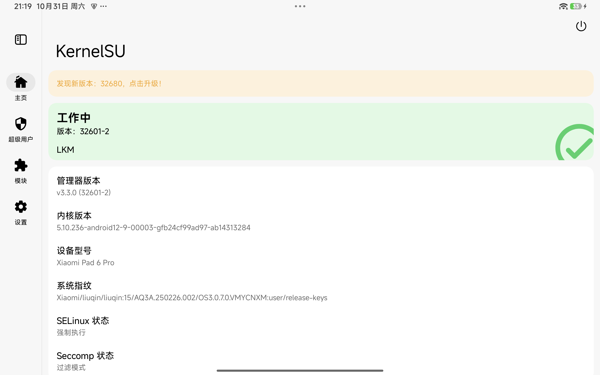

# 整合报告：原生系统 `OS3.0.7.0.VMYCNXM`

状态：**本人真机验证（2026-10-31）**，非上游维护配置。
本分支记录如何把本项目的双系统方案跑到**比安装器固定版本更新的原厂 ROM** 上，并提供唯一需要改动的文件。

## 实际使用的设备与版本

| 项目 | 值 |
|---|---|
| 设备 | 小米平板 6 Pro，代号 `liuqin`，型号 `23046RP50C`，256 GB |
| SoC | 高通 SM8475（骁龙 8+ Gen 1）|
| 引导 | 已解锁（`verifiedbootstate=orange`）|
| 原厂 Android | **`OS3.0.7.0.VMYCNXM`**（Android 15，构建 `AQ3A.250226.002`）|
| 系统指纹 | `Xiaomi/liuqin/liuqin:15/AQ3A.250226.002/OS3.0.7.0.VMYCNXM:user/release-keys` |
| Android 内核 | `5.10.236-android12-9-00003-gfb24cf99ad97-ab14313284` |
| Ubuntu | Ubuntu 26.04 LTS，项目内核 `6.17.0-rc1` |

## 为什么要做这个整合

上游安装器会用 `liuqin-rom-images.json` 里固定的 SHA256 校验原厂 ROM 目录，
固定的是 `OS2.0.6.0.VMYCNXM`（2025-03-18）。`verify_rom()` 会直接拒绝其它版本，
`--allow-unverified` 只影响 bundle 状态、**不能**跳过 ROM 校验。

`OS3.0.7.0.VMYCNXM` 的分区几何与固定版本完全一致（`boot` 201326592 B、
`vendor_boot` 100663296 B、`dtbo` 25165824 B、`NON-HLOS` 114511872 B、`super` 为
sparse），且 `anti_version=1`，与设备 fuse（`fastboot getvar anti` = `1`）一致。
只是校验和不同，因此只需要让安装器接受本地文件的真实字节。

## 相对上游的改动

仅 `install.py` 的 `verify_rom()`。附带的 `tools/install_os3070.py` 除此之外与上游
逐字节一致（保留 MIT 许可与文件头）。改动把"硬拒绝"换成"警告 + 按本地文件重算
identity"，并保留固定的分区映射与 sparse 标记：

```diff
-        if path.stat().st_size != entry['bytes'] or sha(path) != entry['sha256']:
-            parser.error('ROM image does not match the pinned ' + table['rom'] + ' release: ' + name ...)
-        selected[name] = dict(entry, path=path)
+        actual_bytes = path.stat().st_size
+        actual_sha = sha(path)
+        if actual_bytes != entry['bytes'] or actual_sha != entry['sha256']:
+            print('WARN: ' + name + ' differs from pinned ' + table['rom'] +
+                  ' (using local bytes; unpinned ROM test)')
+        selected[name] = dict(entry, path=path, bytes=actual_bytes, sha256=actual_sha)
```

分区规划、补零的项目启动镜像、RAM 安装器、双布局、切换仓库等逻辑均未改动。

## 实际操作步骤

1. **先用原厂 `OS3.0.7.0.VMYCNXM` 线刷包全量刷机**，让固件、`super`、`modem`、
   `bluetooth`、`dsp` 与系统同版本。原厂 `flash_all.bat` 使用 `*_ab` 分区名，
   platform-tools 不支持，需改成显式 `_a`/`_b` 刷写：
   * 大部分分区用 platform-tools 37；
   * `vm-bootsys` 用 37 会报 `failed to check sparse crc`（新 fastboot 会跳过
     sparse 镜像的 AVB footer），改用 MiFlash 2022 自带的 fastboot 29.0.5 刷写成功。
2. **用修改版安装器装双系统**：

   ```sh
   python tools/install_os3070.py --bundle <bundle-dir> --serial <serial> \
     --backup <backup-dir> --erase-userdata --layout dual \
     --rom-dir <解压后的 OS3.0.7.0 ROM> --yes
   ```

   结果布局与上游默认一致：`userdata` 96 GiB、`linux_root` 32 GiB、
   `linux_home` 97 GiB，两个系统都从 A 槽启动。
3. **打 KernelSU Android 启动镜像**（使用上游 v0.6.0 包内工具与固定的
   KernelSU v3.3.0 资源）：

   ```sh
   python tools/patch-android-boot-ksu.py \
     --boot <ROM>/images/boot.img \
     --ksuinit <ksuinit-aarch64> \
     --lkm <lkm-aarch64-android12-5.10_kernelsu.ko> \
     --out boot-ksu.img --report boot-ksu-report.json
   ```

   在 Ubuntu 侧 `sudo liuqin-switch import-android boot-ksu.img` 导入，再
   `sudo liuqin-switch to-android` 激活。
4. **Android 侧**安装 KernelSU 管理器 APK 与本项目模块
   `liuqin_boot_ubuntu-v0.3.zip`，之后即可用模块 WebUI 的
   「重启到 Ubuntu」按钮切换。

## 验证结果

两个方向都在真机验证过：

* **Android → Ubuntu**：KernelSU 模块写入 `boot_a`、回读校验、重启，Ubuntu 26.04 正常启动；
* **Ubuntu → Android**：`sudo liuqin-switch to-android`，Android 15 正常启动。

Ubuntu 侧 `liuqin-switch status` 关键输出：

```
running slot:     a
store/ubuntu    ok  7a368e58291f974f1cebd1e91e81ce8edc7256a19f75c4baea3fffd883157900
store/android   ok  2a39502e1b587740c6a643b963de529e0a8a7dc50811553c8817a2c5128bdde4
```

其中 `2a39502e…` 是打过 KernelSU 补丁的 Android 启动镜像
（原厂 `OS3.0.7.0` 的 `boot.img` 为 `9dd14961…`）。

KernelSU 管理器显示 **工作中**（LKM 模式，管理器 v3.3.0 / 32601-2），内核为
`5.10.236-android12-9`。注意：在 `adb shell` 里看不到 `/sys/module/kernelsu`
或 `su` 并不代表没生效——KernelSU 会对非特权上下文隐藏自己，以管理器状态为准。



## 已知限制与警告

* 这**不是**上游验证过的配置。上游仍固定 `OS2.0.6.0.VMYCNXM`，本分支仅作社区报告。
* 固定的 KernelSU LKM 的 vermagic 是 `5.10.252-dirty`，而 ROM 内核是
  `5.10.236-android12-9`；`ksuinit` 会在加载时改写 vermagic，本机可用，
  但换其它 ROM/内核不保证。
* 安装后**不要**再运行原厂 `flash_all`：它会把 Android 启动镜像写回 `boot_a`，
  破坏 Ubuntu 启动路径。模块的 `service.sh` 已自动冻结 Android 系统更新。
* 本分支**不分发**小米固件与启动镜像，请自行从小米获取。
* 恢复：保留解压后的原厂 ROM 与安装器的 `--backup` 目录（分区表、`boot_a`、
  `boot_b`、`persist`）。用 `install.py --restore-partition-table` 加全量线刷即可回到原厂。

## 指纹 TA 固件（补记）

项目把 10 个 FPC TA 文件（`fpcliu.mdt`、`fpcliu.b00`~`b08`）的 SHA256 固定在
`OS2.0.6.0.VMYCNXM` 上。实测刷 `OS3.0.7.0.VMYCNXM` 后有 2 个文件不同
（`fpcliu.mdt`、`fpcliu.b08`），服务报
`stock FPC firmware hash mismatch: fpcliu.mdt`。

两种处理都验证过服务 / 传感器 / fprintd 能起来：

- **A**：把 `firmware/SHA256.json` 改成本机 `modem_a` 的实际值；不需要下载旧 ROM，
  但属于未验证组合，测试机上录入未完成（`pipeline_incomplete=finger_lost_wait`）；
- **B**：从官方 OS2.0.6.0 线刷包提取 `NON-HLOS.bin`，把 10 个 `fpcliu.*` 放入固件缓存
  （哈希与固定值全部一致，即上游验证过的组合；测试机最终采用此方案）。

详见 [fingerprint-firmware.md](fingerprint-firmware.md)。
